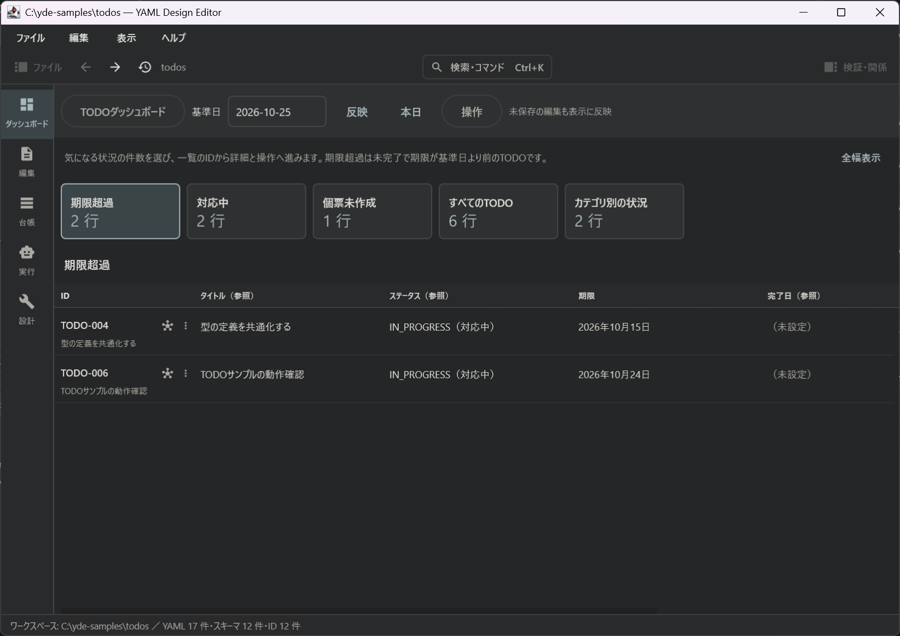
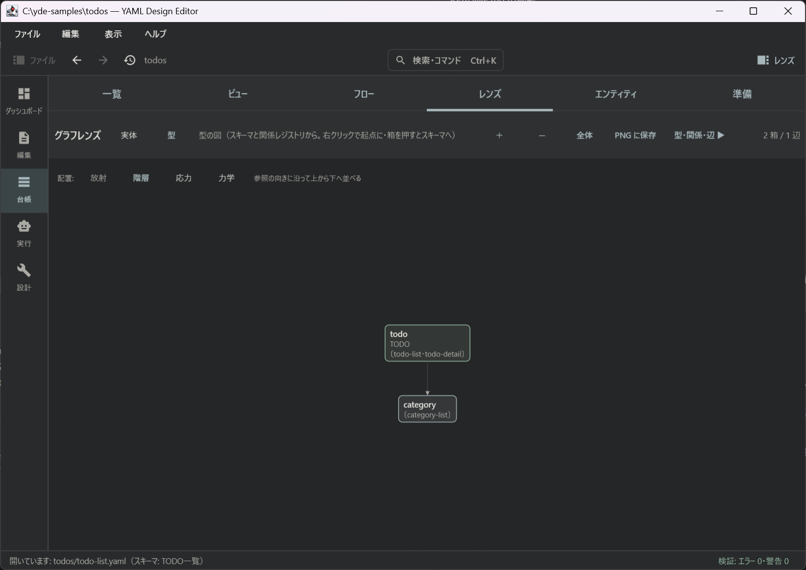
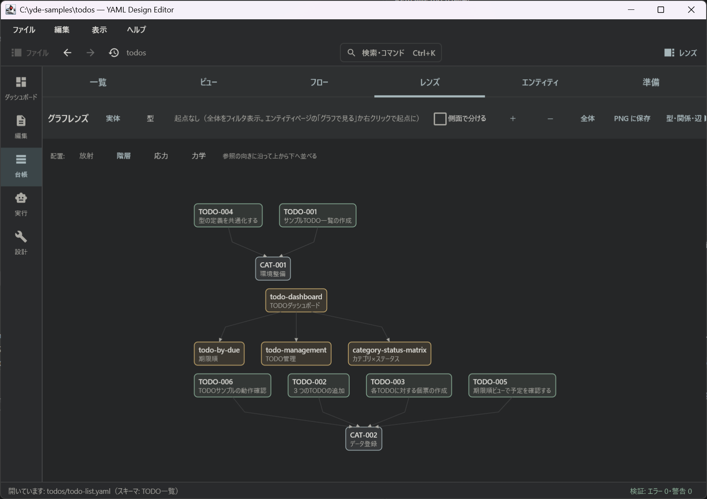
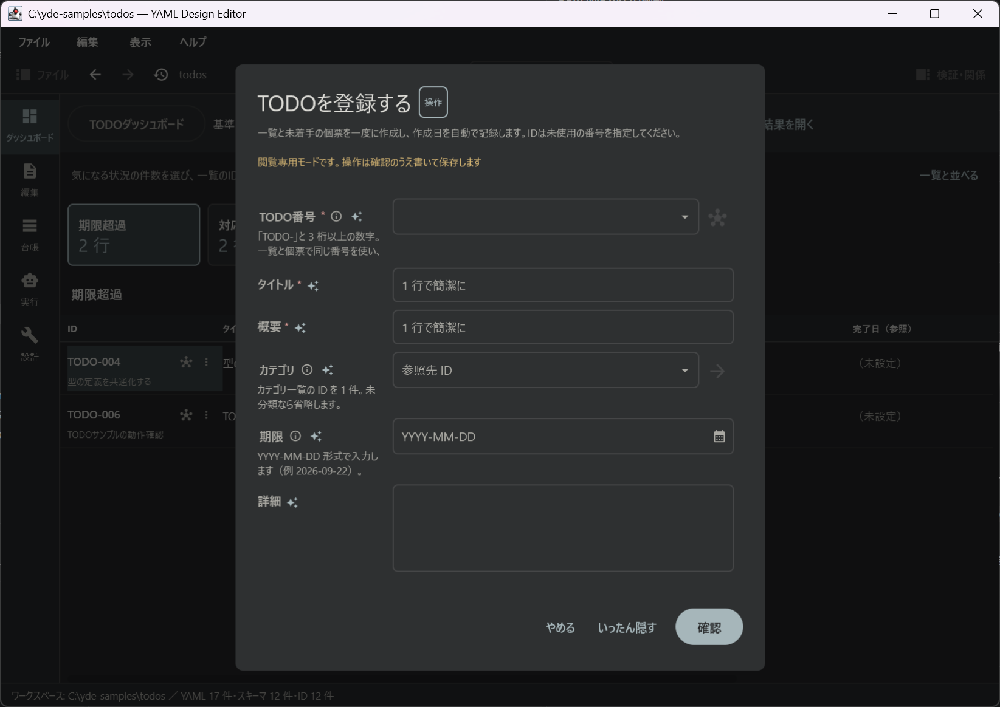
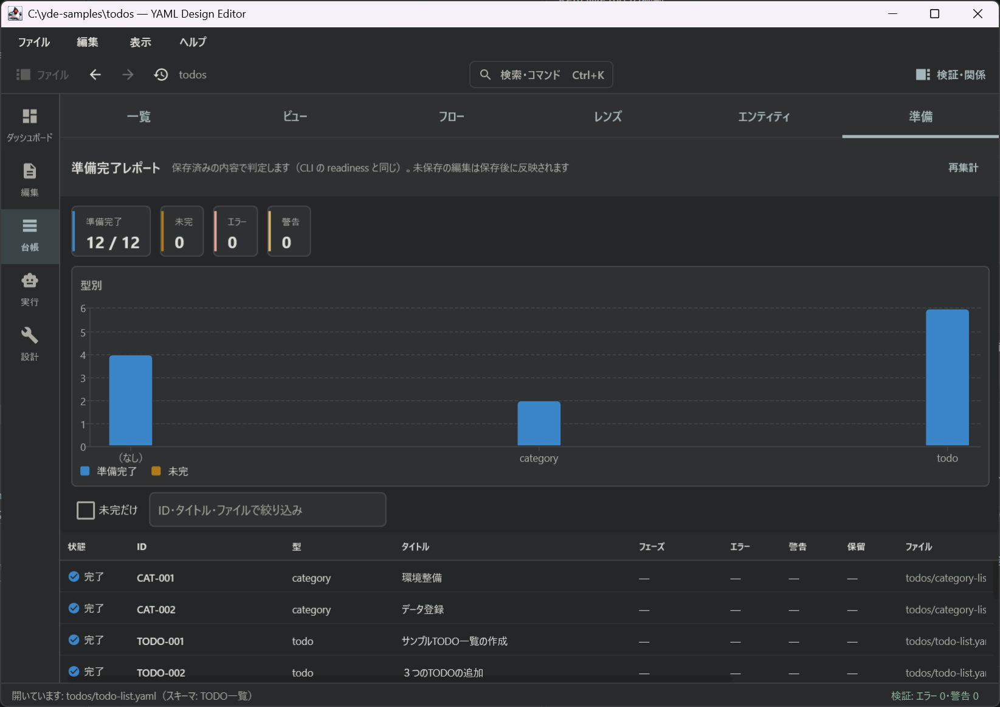
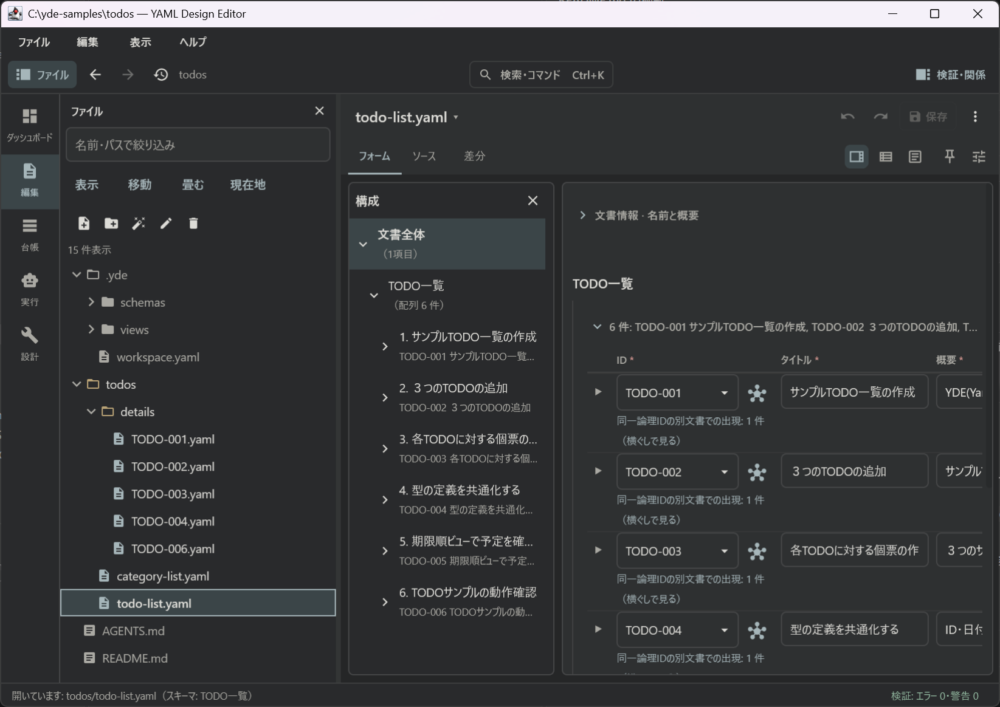
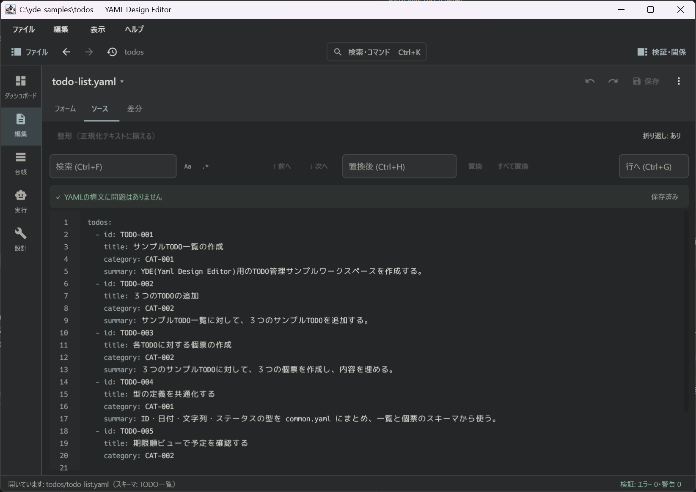
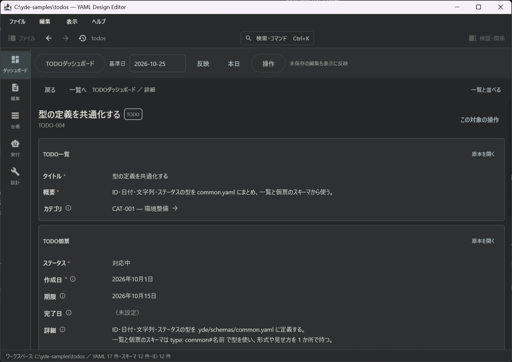

# YAML Design Editor

[](https://github.com/myanya/yaml-design-editor/releases)
[](LICENSE)


**情報に形を与え、操作を決める。それだけで、ひとつのアプリケーションになります。**

YAML Design Editor（YDE）は、TODO や家計簿、システムの設計情報、用語集、台帳といった「構造を持つ情報」を、フォルダの中の YAML ファイルとして管理するためのデスクトップアプリです。
情報の形（スキーマ、ID、参照）と、情報に対する操作（検査、ビュー、業務の操作、エージェント）を YAML で定義しておくと、入力フォームやダッシュボード、検証、操作の実行、AI による作成支援を YDE が用意します。
業務ごとにプログラムを書く必要はありません。定義もデータも YAML なので、人と AI エージェントが同じ道具で読み書きできます。AI が書いたものは検証を通し、人が差分を確かめてから原本に取り込みます。



画面はすべて TODO 管理サンプル（[samples/todos](samples/todos/README.md)）を開いたものです。YDE 自体は特定の業務を持たず、何を管理するかは YAML の定義で決まります。

## 情報の構造化 ＋ 情報の操作 ＝ アプリケーション

YDE の考え方は、この一行に尽きます。

| | 何をするか | YAML に書くこと |
|---|---|---|
| **情報の構造化** | 情報の形を決めます | スキーマ、型、ID と参照、工程（フェーズ）、保存時に自動で入る値 |
| **＋ 情報の操作** | 情報の動かし方を決めます | 検査、ビュー、ダッシュボード、業務の操作、エージェント、取り込みと書き出し |
| **＝ アプリケーション** | YDE が用意します | フォーム・ソース・差分での編集、横ぐしの一覧、検証、操作の実行、AI 支援、CLI |

同じしくみの上に、業務の異なるアプリケーションを組み上げられます。

| 作りたいもの | 形（構造化） | 操作 | 例 |
|---|---|---|---|
| TODO 管理 | TODO、カテゴリ、状態、期限 | 登録、着手、完了、再開、中止の操作と、期限超過を映すダッシュボード | [samples/todos](samples/todos/README.md) |
| 注文管理 | 注文、注文明細、顧客、会社、商品、商品カテゴリー | 明細の金額と合計の検査、顧客別・会社別・カテゴリー別・月別の集計とチャート、出荷と取消の操作 | [samples/orders](samples/orders/README.md) |
| 家計簿 | 月、費目、取引、期首残高 | 銀行の CSV の取り込み、月と費目ごとの集計、残高の検査 | [labs/kakeibo](labs/kakeibo/README.md) |
| システム開発の設計情報 | 要件、業務フロー、画面、API、テーブル、試験 | 参照の網羅、多重度、状態遷移の到達性の検査と、準備完了レポート | [labs/sysdev-template](labs/sysdev-template/README.md) |
| 原稿、用語集、顧客台帳、点検記録など | 項目と ID をスキーマに書きます | 検査、ビュー、操作、エージェントを必要な分だけ足します | 「新しいワークスペースを作る…」の「自分の項目で」から始めます |

YDE が向いているのは、情報をスキーマで構造化でき、成果を差分で確かめられ、少しずつ積み上げていく仕事です。
一度きりの自由な文書作成や、複数人が同時に編集する用途には向いていません。

## 主な機能

**形を決める（情報の構造化）**

- スキーマは `_schemas/` に YAML で書きます。型を定義して使い回したり、`$ref` で共通部品を参照したり、enum の値ごとに項目を足したりできます。
- 工程（フェーズ）に応じて必須項目を変える、値を式で求める、保存時に更新日や版を自動で入れる、といったこともスキーマで指定します。
- ワークスペース全体の ID を索引化し、参照を解決します。同じ ID が複数の文書に現れるときは、エンティティページで 1 枚に合成して見られます。一覧を書いてから個票で詳しくする、段階的な詳細化に向いています。
- 入れ子で書いた要素の「保有・所属」の関係にも名前を付けられます。
- 形はあとから直せます。既存の YAML からスキーマを推測したり、表定義書から検証用のスキーマを導いたりできます。スキーマを変えるときは既存の文書を追随させ、ID の改名や統合、削除、ファイルの移動も参照を追随させて 1 回で行います。

|  |  |
|:--:|:--:|
| スキーマの構造。TODO がカテゴリを参照する、という形が図になります | 管理している情報の関係。TODO、カテゴリ、ビューのつながりを眺められます |

**操作を決める（情報の操作）**

- 検査は YAML の定義体で宣言します。構造や参照のほかに、関係の多重度や循環、パターンによる制約、網羅マトリクス、状態遷移の到達性、宣言した値と導出した値の整合、詳細文書の存在などを確かめられます。
- 組込みの検査も利用者が書く検査も同じしくみです。結果は「違反」「充足」「保留」「対象外」の 4 つに分け、指摘が無いことと正しいことを混同しないようにしています。
- ビューとダッシュボードを定義すると、複数の文書を横断する一覧、クロス集計、文書ビュー、業務フロー図、グラフレンズ（実体の段と型の段）で情報を眺められます。
- ダッシュボードは業務の入口です。基準日で絞った件数から一覧、業務詳細、操作へと進めます。
- 「TODO を完了する」のような業務の操作を定義できます。前提の確認、入力、差分の確認、適用を共通の流れで行い、画面でも CLI でも AI エージェントからでも同じ名前で呼べます。
- エージェントの仕事は `_agents` と `_activities` に定義します。エージェントは文書を探索し、複数の文書を編集し、自分で検証してから、変更セットとして提出します。
- トリガや連鎖、リトライによる自動実行と、評価セットによる回帰評価や A/B 比較もできます。
- Excel、CSV、JSON、Markdown、Word からの取り込みと、Excel、CSV、JSON、Markdown、HTML への書き出しを宣言型で定義できます。原本は常に YAML です。

|  |  |
|:--:|:--:|
| 「TODO を登録する」の操作。入力、確認、適用の流れは YAML の定義から作られます | 準備完了レポート。残っているエラーをエンティティごとに示します |

**YDE が用意するもの（アプリケーションとして動く部分）**

- 編集はフォーム、ソース、差分の 3 つの見方で行います。フォームには表形式の表示、日付の選択、ドラッグでの並べ替え、画像の表示があり、ソースには補完、検証の指摘、折り畳み、保存済みとの差分の印があります。
- スキーマの無い文書も、汎用のツリーで編集できます。
- 保存してもコメントやキーの順序、引用符の付け方はそのまま残ります。Undo/Redo はワークスペース全体で 1 本です。外部でファイルが変わったことを検出し、競合から編集内容を守ります。
- 参照先へのジャンプ、補完、バックリンク、コマンドパレット、検証パネル、エンティティ単位で残りのエラーを示す準備完了レポートがあります。
- 業務の操作は閲覧専用モードでも実行できます。
- AI 支援は OpenAI、Anthropic、Azure、OpenAI 互換サーバに接続し、スキーマに沿った構造化出力で生成します。API キーはメモリにだけ保持し、ファイルには保存しません。
- ヘッドレス CLI から、探索、検索、検証、部分的なパッチ、操作、エージェントの実行、YAML から YAML への変換を行えます。出力は機械可読な YAML です。

|  |  |
|:--:|:--:|
| フォームでの編集。ファイルの一覧、構成、表形式のフォームを並べて使います | ソースでの編集。検索と置換、構文の状態、補完や検証の指摘があります |

## 試してみる

### Windows（ZIP 版）

Java を別途インストールする必要はありません。

1. [Releases](https://github.com/myanya/yaml-design-editor/releases) から `yaml-design-editor-<版>-windows-x64.zip` をダウンロードし、すべて展開してから `yaml-design-editor.exe` を起動します。
2. サンプルを見るなら、同梱の `examples/todos` を作業用のフォルダへコピーし、「ワークスペースを開く…」でそのコピーを開きます。
3. 自分の情報を管理するなら、スタート画面の「新しいワークスペースを作る…」から、テンプレートか自分の項目で始めます。4 つの画面に答えると、定義一式ができて開きます。
4. 起動と更新の案内は ZIP 内の `README.txt` に、各版の内容は[チェンジログ](docs/archive/changelog.md)にあります。

ZIP には署名を付けていないため、Windows が発行元についての警告を表示することがあります。添付の `SHA256SUMS.txt` でチェックサムを照合してください。
この README はリポジトリの最新の状態に合わせて書いています。ZIP 版で使える機能の範囲は、その版のリリースノートで確かめてください。

### ソースから起動する（Windows / macOS / Linux）

JDK 21 が必要です。無ければ Gradle が自動で取得します（`./gradlew` を動かす JDK は 17 以上で構いません）。
初回のビルドでは、等幅フォント Cica（約 23 MB）を GitHub から取得するためにネットワーク接続が必要です。2 回目以降は不要です。

```bash
./gradlew run                                             # スタート画面から開く
./gradlew run --args="path/to/workspace"                  # ワークスペースを指定して開く
./gradlew runCli -q --args="help"                         # ヘッドレス CLI のコマンド一覧
./gradlew runCli -q --args="validate path/to/workspace"   # 全文書の検証を CLI で行う
./gradlew runCli -q --args="init my-ws --template issues" # テンプレートからワークスペースを作る（引数なしで一覧。--adopt で既存フォルダへ後入れ）
```

### 3 分で「定義だけでアプリになる」を確かめる

`samples/todos` をコピーして開くと、「TODO ダッシュボード」が表示されます。この TODO 管理アプリには、プログラムが 1 行もありません。

1. 「期限超過」の件数を押すと一覧に切り替わります。ID を押して業務詳細を開きます。
2. 「この対象の操作」から「TODO を完了する」を選び、結果を入力して確認、適用します。一覧と個票の 2 つの文書がまとめて更新されます。
3. `Ctrl+Z` で元に戻せます。「原本を開く」で業務データの YAML を、`.yde/schemas/operations.yaml` で操作の定義を見てみてください。形も操作も、すべて YAML で書かれています。



業務詳細では、一覧と個票の 2 つの文書に分かれて書かれている TODO を、1 枚にまとめて表示します。

詳しい手順と、見てほしい観点は [samples/todos/README.md](samples/todos/README.md) にあります。

## テンプレート、サンプル、実験場

| 場所 | 内容 |
|---|---|
| [templates/](templates/README.md) | 新しいワークスペースの出発点です。「課題管理」と、問いに答えて作る「基本の一覧」があります。業務を限定しない少数の雛形に保ちます |
| [samples/todos](samples/todos/README.md) | 個人向けの TODO 管理です。型、検査、操作、ビュー、ダッシュボードが一式そろっていて、AI に接続しなくてもそのまま使えます |
| [samples/todos-sysdev-tablemodel](samples/todos-sysdev-tablemodel/README.md) | 同じ TODO 管理を専用のシステムとして作るときの、概念・論理・物理モデルと、SQL 生成の検討です |
| [samples/orders](samples/orders/README.md) | 注文管理です。注文が顧客を、顧客が会社を、明細が商品を、商品がカテゴリーを参照する複数の種類の情報を、金額の検査と顧客別・会社別・カテゴリー別・月別の集計、チャート、出荷と取消の操作つきで管理します |
| [labs/kakeibo](labs/kakeibo/README.md) | 家計簿を題材に、月と費目ごとの集計、残高の検査、銀行の CSV の取り込みを試しています |
| [labs/sysdev-template](labs/sysdev-template/README.md) | 会議室予約システムを題材に、要件から設計、試験までの文書体系と、設計の機械的な検証を試しています |
| [labs/sysdev-todo](labs/sysdev-todo/README.md) | TODO Web アプリの設計体系です。ドメインの定義から画面、API、テーブルの設計を導きます |
| [labs/user-man](labs/user-man/README.md) | 架空のユーザ管理システムを題材に、業務フローから設計情報をどう表すかを試しています |

`templates/` は出発点で、`samples/` は特色を紹介する公開用のサンプルです。新しい試作は `labs/` で作り、形になったら `samples/` へ移します。

## ドキュメント

| 文書 | 内容 |
|---|---|
| [利用者マニュアル](docs/manual/README.md) | 画面、スキーマ定義、検証、ファイル、ビュー、ダッシュボード、ID、操作、AI、CLI の使い方 |
| [既知の制約](docs/manual/limits.md) | 安全に使うための前提と、YAML の読み書きや編集で残る制約 |
| [チュートリアル](docs/tutorial.md) | タスク管理を題材にした、文書の作成とスキーマ設計の手引きです。ビューと AI 以降の章は執筆中です |
| [チェンジログ](docs/archive/changelog.md) | リリースごとの追加、変更、修正 |
| [機能索引](docs/FEATURES.md) | 機能から実装ファイルとテストを引く索引 |
| [設計](docs/architecture/README.md) | 主題ごとの部品、流れ、規律、拡張ポイント |
| [設計の決定（ADR）](docs/decisions/README.md) | 依存方向や計算体系などの決定の記録 |
| [開発規約](docs/CONVENTIONS.md) | コード、テスト、文書の規約 |
| [ロードマップ](docs/ROADMAP.md) | ビジョンと、まだ終わっていないテーマ |
| [Windows ZIP の配布](docs/releasing.md) | 配布物の作成、検査、公開の手順 |
| [CLAUDE.md](CLAUDE.md) / [AGENTS.md](AGENTS.md) | AI コーディングエージェント向けの作業ガイド |

## 開発する

```bash
./gradlew test                                   # 単体テスト
./gradlew hotRun                                 # Compose Hot Reload 付きで起動（保存すると画面に反映。JetBrains Runtime 21 を自動取得）
./gradlew runCli -q --args="version"             # 外部バージョンと内部バージョン（yyyymmdd.ビルド番号）を表示
./gradlew windowsRelease --no-parallel           # 全テストのあと、Windows ZIP、SHA-256、リリース本文を作る
./gradlew packageDistributionForCurrentOS        # 開発用。この OS 向けの msi / dmg / deb を作る（配布として検査しているのは Windows ZIP だけ）
```

- モジュールは `yaml-core ← semantic-core ← workspace-core ← app-core ← アプリ` の順に、一方向だけ依存します（cli はカーネルまで）。
- 起動中の画面を AI エージェントから操作するための MCP サーバ（スクリーンショット、クリック、入力、再読込）の設定を `.mcp.json` に置いています。Windows 向けの設定なので、mac や Linux では `cmd /c gradlew.bat` を `./gradlew` に読み替えてください。
- バージョンは、利用者に見せる外部バージョン（`gradle.properties` の `appVersion`）と、開発管理用の内部バージョン（ビルド時に git から算出）の 2 つを持ちます。

## いまの状態

- 外部バージョンは 0.1 系です。配布しているのは Windows x64 向けの ZIP だけで、macOS と Linux ではソースから起動できます。MSI インストーラー、署名、自動更新はありません。
- 自分で作ったワークスペースか、内容を確認したワークスペースを開いてください。前提と制約は[既知の制約](docs/manual/limits.md)にまとめています。
- AI 機能は任意です。通常の編集と保存に API キーは要りません。

## ライセンス

MIT License（[LICENSE](LICENSE)）。Copyright (c) 2026 myanya, toros

第三者のライブラリ、フォント、Java ランタイムには、それぞれのライセンスが適用されます。[同梱物の案内](THIRD-PARTY-NOTICES.txt)を参照してください。
配布ビルドでは、解決した依存の表示とソースの取得先を生成し、アプリの資源ディレクトリ内の `licenses/` に同梱します。
